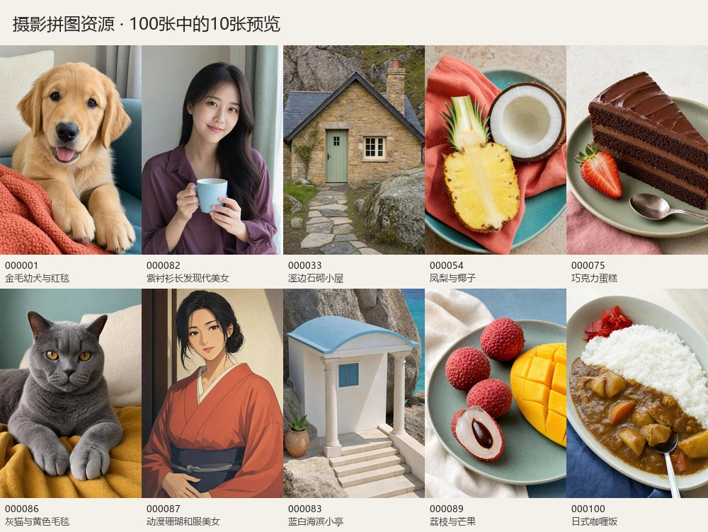

# Art Puzzle 图片资源

用于 ArtBlockPuzzle 拼图项目的独立图片仓库。当前收录 100 张已完成视觉筛选的图片，宠物、人物、风景、水果、食物各 20 张。人物均为成年亚洲女性：现代写真 10 张、古装写真 6 张、动漫 4 张。



## 目录

```text
.
├── README.md
├── manifest.json
├── images/
│   └── 001/
│       ├── 000001.jpg
│       ├── 000002.jpg
│       └── … 000100.jpg
└── previews/
    └── overview.jpg
```

## 命名与扩展

- 图片使用全局连续、六位补零的编号，扩展名统一为小写 `.jpg`。编号作为稳定资源 ID，已经发布后不要重新编号或改名。
- 每 100 张一个目录：`001` 存放 `000001`～`000100`，`002` 存放 `000101`～`000200`，依此类推。目录号为 `floor((ID - 1) / 100) + 1`，至少三位补零。
- 分类存放在清单中，不按题材移动图片，因此更改分类不会改变文件路径。新增图片从 `000101.jpg` 开始，放入 `images/002/`，并同步更新清单。
- `previews/` 仅供查看总览，游戏读取 `images/` 中的独立图片。

## 图片与清单

图片规格为 **1000×1480、RGB JPEG、宽高比 25:37**。当前 100 张图片总计约 20.18 MB。图片通过 OpenAI API 文生图生成，模型为 `gpt-image-2`，包含摄影风格与明确指定的动漫人物风格。素材已做视觉筛选；尚未在游戏内逐关试玩全部图片。

`manifest.json` 的 `images` 数组记录 `id`、`category`、`title`、`style`、相对 `path`、尺寸、文件字节数和 SHA-256。分类 ID 为 `pets`、`people`、`scenery`、`fruit`、`food`。文件复制时已与原入选图逐字节哈希核验。

运行时可将配置的资源基础 URL 与清单里的 `path` 拼接，文件下载后按 SHA-256 校验；不需要在移动端执行 Git 操作。清单仅描述图片，不包含关卡网格与初始排列。上传后还需在游戏项目配置实际远程地址与缓存流程。

## 上传到 GitHub

本地分支为 `main`，可使用 GitHub Desktop 将此目录作为已有仓库发布，也可先在 GitHub 创建空仓库，再在本目录执行：

```powershell
git remote add origin <你的GitHub仓库地址>
git push -u origin main
```

中文说明和 JSON 使用 UTF-8、LF 换行；JPG 按二进制存储，保持原文件哈希。仓库内容为入选图片、清单和预览，不包含生成原图、淘汰版本、API 密钥或日志。
